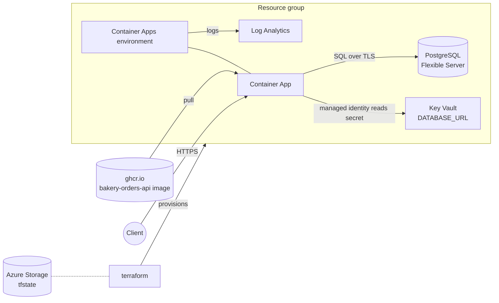

# azure-terraform-platform

Terraform that hosts the [bakery-orders-api](https://github.com/b0tjim/bakery-orders-api)
container on Azure: Container Apps, PostgreSQL Flexible Server, Key Vault, Log Analytics,
and remote state in Azure Storage.

[](https://github.com/b0tjim/azure-terraform-platform/actions/workflows/ci.yml)
[](versions.tf)
[](LICENSE)

> **Honest status:** the code passes `fmt`, `validate`, tflint and checkov in CI, but it has never
> been planned or applied against a real Azure subscription (the author has no credentials wired up).
> The plan/apply workflows skip themselves until the repo variables below are set.

## What this demonstrates

- **Infrastructure as code**: small reusable Terraform modules composed in one root config, with
  `dev`/`prod` sizing in tfvars instead of copy-pasted environments.
- **Secrets handling**: the DB password is generated by Terraform, stored in Key Vault, and read by the
  Container App through a user-assigned managed identity; nothing secret lives in the repo or in GitHub.
- **Keyless CI/CD auth**: GitHub OIDC federated credentials with `azure/login`, no client secrets.
- **Guard rails**: fmt/validate, tflint (azurerm ruleset) and checkov on every push, with skipped
  checks documented; `apply` runs only after a manual approval on the `production` environment.
- **Remote state**: azurerm backend in a storage account created by a bootstrap script.
- **Cost awareness**: a per-environment monthly estimate and the knobs that drive it.

## Architecture



## Layout

| Path | What it is |
| --- | --- |
| `main.tf`, `variables.tf`, `outputs.tf` | Root config that wires the modules together |
| `backend.tf` | `azurerm` remote state (partial config, filled in at `init`) |
| `modules/resource-group` | Resource group with naming and tags |
| `modules/log-analytics` | Log Analytics workspace |
| `modules/postgres` | Flexible Server, database, Azure-services firewall rule |
| `modules/key-vault` | RBAC-mode vault holding the DB password and `DATABASE_URL` |
| `modules/container-app` | Container Apps environment, app, and user-assigned identity for Key Vault access |
| `envs/dev.tfvars`, `envs/prod.tfvars` | Per-environment sizing |
| `scripts/bootstrap-state.sh` | Creates the storage account for remote state |
| `.github/workflows` | `ci.yml` (fmt, validate, tflint, checkov), `plan.yml`, `apply.yml` |

## Run locally (no Azure needed)

This checks the configuration without touching any cloud:

```bash
terraform init -backend=false
terraform fmt -check -recursive
terraform validate
```

A real `plan`/`apply` needs an Azure subscription and remote state; those steps run only in the
GitHub workflows (see below).

## Running the plan/apply workflows (OIDC, no stored secrets)

`plan.yml` and `apply.yml` log in with `azure/login` using GitHub's OIDC token exchanged for a
short-lived Azure token through a federated credential. Until the repo variables below exist, both
workflows are skipped, so CI stays green without an Azure account. None of these steps have been run
by the author (no subscription); they are the intended setup.

```bash
# 0. Log in and pick the subscription
az login
SUB=$(az account show --query id -o tsv)
TENANT=$(az account show --query tenantId -o tsv)
REPO=b0tjim/azure-terraform-platform

# 1. Remote state storage account (prints the account name)
scripts/bootstrap-state.sh eastus2

# 2. App registration + service principal used by GitHub
APP_ID=$(az ad app create --display-name gh-azure-terraform-platform --query appId -o tsv)
az ad sp create --id "$APP_ID"

# 3. Federated credentials: one per way the workflows authenticate
#    (pull_request for plan.yml, branch main, and the "production" environment for apply.yml)
for SUBJECT in "pull_request" "ref:refs/heads/main" "environment:production"; do
  az ad app federated-credential create --id "$APP_ID" --parameters "{
    \"name\": \"gh-${SUBJECT//[:\/]/-}\",
    \"issuer\": \"https://token.actions.githubusercontent.com\",
    \"subject\": \"repo:${REPO}:${SUBJECT}\",
    \"audiences\": [\"api://AzureADTokenExchange\"]}"
done

# 4. Permissions. Owner (or Contributor + User Access Administrator) is needed because the
#    key-vault module creates role assignments. Scope it to the subscription or a dedicated one.
az role assignment create --assignee "$APP_ID" --role Owner --scope "/subscriptions/$SUB"
# Reading/writing state with Entra auth is not used; the backend uses the same identity:
az role assignment create --assignee "$APP_ID" --role "Storage Blob Data Contributor" \
  --scope "/subscriptions/$SUB/resourceGroups/rg-bakery-tfstate"
```

Then in the GitHub repo:

1. **Settings -> Secrets and variables -> Actions -> Variables**, add (these are IDs, not secrets):
   `AZURE_CLIENT_ID` (= `$APP_ID`), `AZURE_TENANT_ID`, `AZURE_SUBSCRIPTION_ID`,
   `TFSTATE_STORAGE_ACCOUNT`, and optionally `TFSTATE_RESOURCE_GROUP` (default `rg-bakery-tfstate`).
2. **Settings -> Environments -> New environment** named `production`, enable **Required reviewers**
   and add yourself. `apply.yml` pauses on this approval before touching Azure.
3. Run **Actions -> Plan -> Run workflow** (pick `dev` or `prod`) and read the plan.
4. Run **Actions -> Apply**, approve the `production` environment prompt, and it applies the same
   `envs/<env>.tfvars`.

## Rough monthly cost estimate

Ballpark pay-as-you-go prices for `eastus2`, USD, checked against the Azure pricing pages from
memory rather than the pricing calculator, so treat them as +/- 30%. Check the
[Azure pricing calculator](https://azure.microsoft.com/pricing/calculator/) before deploying.

| Item | dev | prod |
| --- | --- | --- |
| PostgreSQL compute (`B_Standard_B1ms` / `GP_Standard_D2s_v3`) | ~$13 | ~$125 |
| PostgreSQL storage (32 GB) + backups | ~$4 | ~$4 |
| Container Apps (0.25 vCPU / 0.5 GiB; dev scales to zero, prod 2 replicas always on) | ~$0-2 | ~$10-40 |
| Log Analytics (first 5 GB/month free) | ~$0-2 | ~$0-5 |
| Key Vault (a few operations) | <$1 | <$1 |
| Remote state storage account | <$1 | shared |
| **Total** | **~$20** | **~$150-180** |

Biggest lever: the Postgres SKU. Run `terraform destroy -var-file=envs/dev.tfvars` when not using
dev, and note a stopped Flexible Server still bills for storage.
