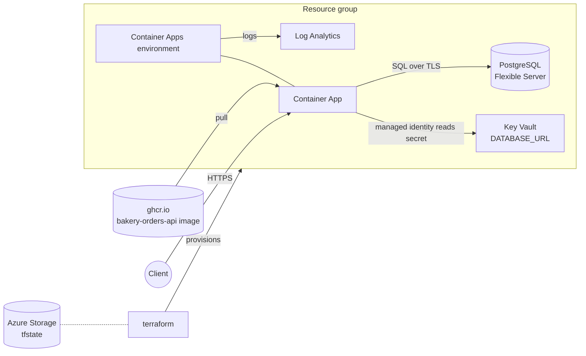

# azure-terraform-platform

Terraform that hosts the [bakery-orders-api](https://github.com/b0tjim/bakery-orders-api)
container on Azure: Container Apps, PostgreSQL Flexible Server, Key Vault, Log Analytics,
and remote state in Azure Storage.

> **Status:** work in progress. See [ROADMAP.md](ROADMAP.md) for what is built so far.
> No Azure credentials are used in development; nothing here has been planned or applied
> against a real subscription.

## Architecture



## Layout

| Path | What it is |
| --- | --- |
| `main.tf`, `variables.tf`, `outputs.tf` | Root config that wires the modules together |
| `backend.tf` | `azurerm` remote state (partial config, filled in at `init`) |
| `modules/resource-group` | Resource group with naming and tags |
| `modules/log-analytics` | Log Analytics workspace |
| `modules/postgres` | Flexible Server, database, Azure-services firewall rule |
| `modules/key-vault` | RBAC-mode vault holding the DB password and `DATABASE_URL` |
| `modules/container-app` | Container Apps environment, app, and user-assigned identity for Key Vault access |
| `envs/dev.tfvars`, `envs/prod.tfvars` | Per-environment sizing |
| `scripts/bootstrap-state.sh` | Creates the storage account for remote state |
| `.github/workflows` | `ci.yml` (fmt, validate, tflint, checkov), `plan.yml`, `apply.yml` |

## Run locally (no Azure needed)

This checks the configuration without touching any cloud:

```bash
terraform init -backend=false
terraform fmt -check -recursive
terraform validate
```

A real `plan`/`apply` needs an Azure subscription and remote state; those steps run only in the
GitHub workflows (see the roadmap for the OIDC setup docs).

More documentation (OIDC setup, cost estimate) will land here as the roadmap progresses.
